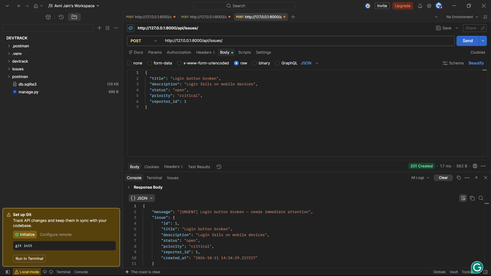
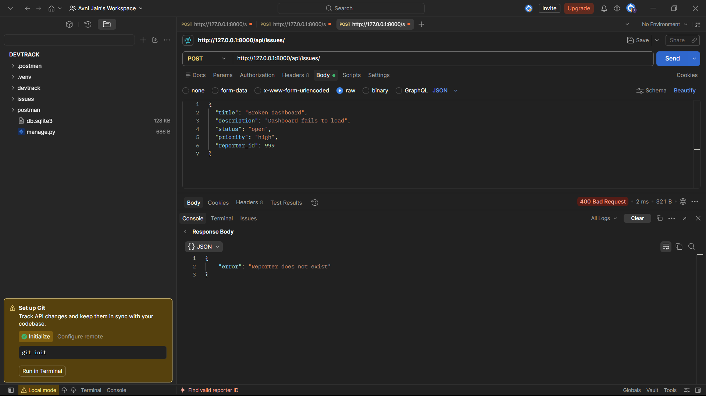

# DevTrack — Engineering Issue Tracking API

A lightweight, object-oriented backend API for managing engineering issues and their reporters. Built with **Python and Django**, DevTrack provides endpoints for creating, retrieving, validating, and filtering issues using JSON files for persistent storage.

The project demonstrates object-oriented programming, inheritance, polymorphism, input validation, API design, and separation of concerns without requiring a database server.

## Table of Contents

- [Overview](#overview)
- [Features](#features)
- [Technology Stack](#technology-stack)
- [Project Structure](#project-structure)
- [Getting Started](#getting-started)
- [API Documentation](#api-documentation)
- [Data Models and Validation](#data-models-and-validation)
- [Error Handling](#error-handling)
- [Design Decisions](#design-decisions)
- [Testing](#testing)
- [Limitations and Future Improvements](#limitations-and-future-improvements)

## Overview

DevTrack is a backend API designed to track engineering issues and associate them with the people who report them.

The application manages two entities:

- **Reporter:** Stores the identity and team information of a person reporting an issue.
- **Issue:** Stores the title, description, status, priority, reporter reference, and creation timestamp of an engineering issue.

Each issue references a reporter through `reporter_id`, allowing one reporter to be associated with multiple issues.

The application uses Django to handle HTTP requests and return JSON responses. Issue and reporter records are persisted in separate JSON files, making the application straightforward to set up and test.

## Features

### Issue management
- Create new engineering issues.
- Retrieve all issues or a specific issue by ID.
- Filter issues by status.
- Assign priority levels to issues.
- Automatically record an issue's creation timestamp.
- Generate human-readable descriptions based on issue priority.

### Reporter management
- Create new reporters.
- Retrieve all reporters or a specific reporter by ID.
- Validate reporter details before saving.
- Associate issues with existing reporters.

### Object-oriented design
- Abstract base class with required methods.
- Inheritance for reporter and issue entities.
- Specialized subclasses for critical and low-priority issues.
- Method overriding to generate priority-specific descriptions.

### Validation and storage
- Validate incoming JSON request bodies.
- Check required fields and allowed status and priority values.
- Reject issues that reference nonexistent reporters.
- Persist records using separate JSON files.
- Return structured JSON error responses for invalid requests and missing resources.

## Technology Stack

| Technology | Purpose |
|---|---|
| Python | Core programming language and OOP implementation |
| Django | HTTP request handling, routing, and JSON responses |
| JSON | File-based data persistence |
| Git and GitHub | Version control and project hosting |
| Postman | API testing and request verification |

The project uses Django's built-in HTTP and URL-routing functionality. It does not require Django REST Framework or an external database.

## Project Structure

```text
DEVTRACK/
├── devtrack/
│   ├── __init__.py
│   ├── settings.py
│   ├── urls.py
│   ├── asgi.py
│   └── wsgi.py
│
├── issues/
│   ├── __init__.py
│   ├── models.py
│   ├── storage.py
│   ├── views.py
│   ├── urls.py
│   ├── issues.json
│   └── reporters.json
│
├── screenshots/
│   ├── create-critical-issue.png
│   └── invalid-request.png
│
├── manage.py
├── requirements.txt
├── README.md
└── .gitignore
```

### Key files

- `issues/models.py` — Defines the abstract base class, reporter and issue classes, validation methods, and specialized issue subclasses.
- `issues/storage.py` — Handles reading, writing, ID generation, and record lookup in JSON files.
- `issues/views.py` — Implements the API endpoints, request validation, and JSON responses.
- `issues/urls.py` — Maps API paths to their corresponding views.
- `devtrack/urls.py` — Includes the application's API routes under `/api/`.
- `requirements.txt` — Lists the project's Python dependencies.

## Getting Started

### Prerequisites

- Python installed on your system.
- pip, Python's package installer.
- Git (optional for running locally, required for version-control workflows).
- Postman or another HTTP client for testing POST requests.

### 1. Clone the repository

After publishing the project to GitHub, clone it using your repository URL:

```bash
git clone <YOUR_GITHUB_REPOSITORY_URL>
cd DEVTRACK
```

Replace the placeholder with the actual repository URL.

Alternatively, open your existing project directory in VS Code.

### 2. Create a virtual environment

On Windows PowerShell:

```powershell
python -m venv .venv
```

Activate it:

```powershell
.\.venv\Scripts\Activate.ps1
```

### 3. Install dependencies

```powershell
python -m pip install -r requirements.txt
```

The current dependency is pinned in `requirements.txt`:

```text
Django==6.1.2
```

### 4. Apply Django migrations

```powershell
python manage.py migrate
```

Django migrations initialize the framework's default database tables. DevTrack's reporter and issue records themselves are stored in JSON files.

### 5. Run the development server

```powershell
python manage.py runserver
```

The local server will be available at:

`http://127.0.0.1:8000/`

The API base URL is:

`http://127.0.0.1:8000/api/`

### 6. Verify the application

Run the Django system check:

```powershell
python manage.py check
```

A successful check should report:

```text
System check identified no issues (0 silenced).
```

## API Documentation

All endpoints return JSON responses. For POST requests, use the `Content-Type: application/json` header and send a valid JSON object in the request body.

### Endpoint summary

| Method | Endpoint | Description |
|---|---|---|
| POST | `/api/reporters/` | Create a reporter |
| GET | `/api/reporters/` | Retrieve all reporters |
| GET | `/api/reporters/?id=1` | Retrieve a reporter by ID |
| POST | `/api/issues/` | Create an issue |
| GET | `/api/issues/` | Retrieve all issues |
| GET | `/api/issues/?id=1` | Retrieve an issue by ID |
| GET | `/api/issues/?status=open` | Filter issues by status |

The IDs in these examples are illustrative; actual IDs depend on the records stored in the JSON files.

### 1. Create a reporter

**Request**

```http
POST /api/reporters/
Content-Type: application/json
```

**Request body**

```json
{
  "name": "Ava Sharma",
  "email": "ava@example.com",
  "team": "backend"
}
```

**Successful response — `201 Created`**

```json
{
  "message": "Reporter created successfully",
  "reporter": {
    "id": 1,
    "name": "Ava Sharma",
    "email": "ava@example.com",
    "team": "backend"
  }
}
```

The ID is generated automatically. Reporter information is validated before being saved.

### 2. Retrieve reporters

**Request**

```http
GET /api/reporters/
```

**Example response**

```json
{
  "reporters": [
    {
      "id": 1,
      "name": "Ava Sharma",
      "email": "ava@example.com",
      "team": "backend"
    }
  ]
}
```

To retrieve a specific reporter, provide the ID as a query parameter:

```http
GET /api/reporters/?id=1
```

If the requested reporter does not exist, the API returns a `404 Not Found` response.

### 3. Create an issue

**Request**

```http
POST /api/issues/
Content-Type: application/json
```

**Request body**

```json
{
  "title": "Login button broken",
  "description": "Login fails on mobile devices",
  "status": "open",
  "priority": "critical",
  "reporter_id": 1
}
```

The referenced reporter must already exist.

**Successful response — `201 Created`**

```json
{
  "message": "[URGENT] Login button broken — needs immediate attention",
  "issue": {
    "id": 1,
    "title": "Login button broken",
    "description": "Login fails on mobile devices",
    "status": "open",
    "priority": "critical",
    "reporter_id": 1,
    "created_at": "2026-10-11 14:34:29.217217"
  }
}
```

The timestamp above is illustrative. The application generates the actual timestamp when an issue is created.

The response intentionally separates the human-readable message from the issue data. The `message` field communicates the result, while the nested `issue` object contains the created resource.

The application chooses the issue subclass based on priority:

- `critical` → `CriticalIssue`
- `low` → `LowPriorityIssue`
- `medium` and `high` → `Issue`

### 4. Retrieve issues

**Request**

```http
GET /api/issues/
```

**Example response**

```json
{
  "issues": [
    {
      "id": 1,
      "title": "Login button broken",
      "description": "Login fails on mobile devices",
      "status": "open",
      "priority": "critical",
      "reporter_id": 1,
      "created_at": "2026-10-11 14:34:29.217217"
    }
  ]
}
```

To retrieve an individual issue:

```http
GET /api/issues/?id=1
```

The response contains the requested issue directly. If the ID does not exist, the API returns `404 Not Found`.

### 5. Filter issues by status

**Request**

```http
GET /api/issues/?status=open
```

Supported statuses:

- `open`
- `in_progress`
- `resolved`
- `closed`

**Example response**

```json
{
  "issues": [
    {
      "id": 1,
      "title": "Login button broken",
      "description": "Login fails on mobile devices",
      "status": "open",
      "priority": "critical",
      "reporter_id": 1,
      "created_at": "2026-10-11 14:34:29.217217"
    }
  ]
}
```

Only issues matching the requested status are returned. If no issues match, the API returns an empty list.

## Data Models and Validation

### BaseEntity

`BaseEntity` is an abstract base class implemented using Python's `abc` module.

It defines two abstract methods:

- `validate()` — Checks whether an entity satisfies its validation rules.
- `to_dict()` — Converts an entity into a dictionary suitable for JSON serialization.

Concrete subclasses must implement both methods. This provides a common interface for the application's entities.

### Reporter

The `Reporter` class inherits from `BaseEntity`.

**Attributes**
- `id`
- `name`
- `email`
- `team`

**Validation rules**
- Name must be a nonempty string.
- Email must contain `@`.
- Team must be a nonempty string.

Reporter data is converted into a dictionary before being persisted.

### Issue

The `Issue` class also inherits from `BaseEntity`.

**Attributes**
- `id`
- `title`
- `description`
- `status`
- `priority`
- `reporter_id`
- `created_at`

**Allowed statuses**

| Value | Meaning |
|---|---|
| `open` | Issue has been reported |
| `in_progress` | Issue is being worked on |
| `resolved` | Issue has been resolved |
| `closed` | Issue has been closed |

**Allowed priorities**

| Value | Meaning |
|---|---|
| `low` | Low urgency |
| `medium` | Normal priority |
| `high` | High urgency |
| `critical` | Requires immediate attention |

The issue title must be a nonempty string. Status and priority must belong to their respective allowed sets.

A creation timestamp is generated when the issue object is initialized.

### Specialized issue classes

**CriticalIssue**

Inherits from `Issue` and overrides `describe()` to return:

```text
[URGENT] <title> — needs immediate attention
```

**LowPriorityIssue**

Inherits from `Issue` and overrides `describe()` to return:

```text
<title> — low priority, handle when free
```

This demonstrates inheritance, method overriding, and polymorphic behavior: the API can call `describe()` on an issue object and receive a message appropriate to its concrete class.

## Error Handling

The API returns JSON error messages for invalid requests and missing records.

| Scenario | Expected HTTP status | Example error |
|---|---:|---|
| Empty reporter name | `400 Bad Request` | `Name cannot be empty` |
| Invalid email | `400 Bad Request` | `Invalid email` |
| Missing issue reporter ID | `400 Bad Request` | `reporter_id is required` |
| Reporter does not exist | `400 Bad Request` | `Reporter does not exist` |
| Invalid issue status | `400 Bad Request` | `Invalid status` |
| Invalid issue priority | `400 Bad Request` | `Invalid priority` |
| Malformed JSON | `400 Bad Request` | `Request body must contain valid JSON` |
| Reporter not found | `404 Not Found` | `Reporter not found` |
| Issue not found | `404 Not Found` | `Issue not found` |
| Unsupported HTTP method | `405 Method Not Allowed` | `Method not allowed` |

Example error response:

```json
{
  "error": "Reporter does not exist"
}
```

The precise error message depends on the validation rule that fails.

## Design Decisions

### 1. Separation of concerns

The application separates entity definitions, data storage, and HTTP request handling into different modules.

- `models.py` defines entity behavior and validation.
- `storage.py` manages JSON file operations and record lookup.
- `views.py` handles incoming requests, calls the relevant logic, and constructs HTTP responses.
- `urls.py` maps request paths to their handlers.

This makes the code easier to understand, test, maintain, and extend without mixing file operations directly into every endpoint.

### 2. Object-oriented design and inheritance

The abstract `BaseEntity` establishes a shared interface for `Reporter` and `Issue`. Specialized issue subclasses override `describe()` to provide priority-specific messages.

This approach reduces duplicated behavior and demonstrates abstraction, inheritance, and polymorphism.

### 3. JSON-based persistence

The project uses separate `reporters.json` and `issues.json` files rather than requiring a database server.

This choice keeps the project lightweight and easy to run locally. The storage layer centralizes file access and provides reusable functions for loading records, saving records, generating IDs, and looking up records.

JSON storage is suitable for this small demonstration project, although a database would be more appropriate for concurrent writes and larger deployments.

### 4. Structured API responses

Successful issue creation returns a `message` alongside a nested `issue` object.

This is an intentional response-format choice: the message communicates the operation's outcome, while the nested object groups the resource's attributes together. It also leaves room for future response metadata without mixing it into the issue fields.

### 5. Referential validation

Before an issue is created, the API checks whether its `reporter_id` refers to an existing reporter.

This prevents issues from being created with references to nonexistent reporters and preserves the intended relationship between the two entities.

## Testing

The API can be tested using Postman, with the development server running locally.

For POST requests:

1. Select the `POST` method.
2. Enter the endpoint URL.
3. Open the **Body** tab.
4. Select **raw** and choose **JSON**.
5. Enter the request payload and click **Send**.
6. Check the HTTP status and JSON response.

For GET requests, select `GET` and enter the appropriate URL or query parameters.

### Successful request: Critical issue creation

The screenshot should show the POST request, its JSON body, the `201 Created` response, and the priority-specific message.



### Failed request: Invalid input

The screenshot should show an invalid request, the `400 Bad Request` response, and the returned JSON error.



## Limitations and Future Improvements

The current implementation focuses on the core requirements of a lightweight issue-tracking API. Possible extensions include:

- **Database integration:** Replace JSON files with SQLite or PostgreSQL for more reliable persistence and concurrent access.
- **Authentication and authorization:** Restrict issue creation and modification to authenticated users.
- **Update and delete operations:** Add endpoints for changing issue details and removing records.
- **Pagination and search:** Support larger collections of issues efficiently.
- **Improved validation:** Add stricter email validation, field-length limits, and explicit type checking for all incoming values.
- **Automated testing:** Add unit tests for entity validation, storage functions, inheritance behavior, and API responses.
- **Concurrency safety:** Add appropriate safeguards for simultaneous writes and ID generation.
- **API documentation:** Generate a formal API schema and interactive documentation.

These are potential future enhancements and are not claimed as implemented features.

## License
No license has been specified yet. Add a license if you intend to make the repository available for reuse by others.